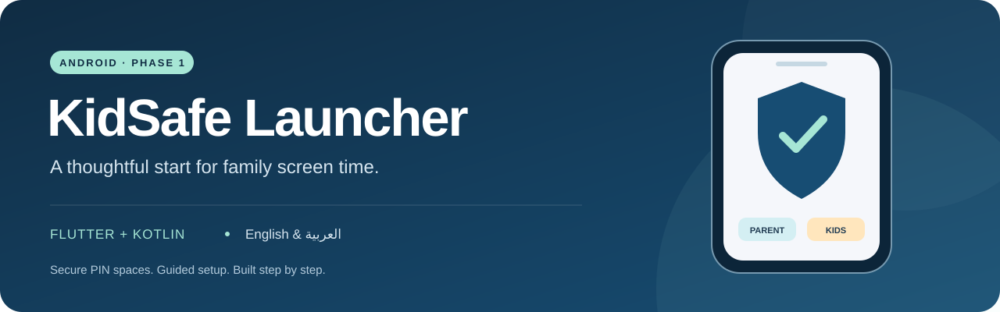

<p align="center">
  
</p>

<p align="center">
  <strong>A parent-controlled Android home launcher, built one tested phase at a time.</strong><br />
  Flutter · Kotlin · English &amp; العربية
</p>

<p align="center">
  <a href="docs/GETTING_STARTED.md">Setup guide</a> ·
  <a href="docs/PHASE1_VALIDATION.md">Validation</a> ·
  <a href="docs/SECURITY.md">Security &amp; Android limits</a> ·
  <a href="docs/ROADMAP.md">Roadmap</a>
</p>

<p align="center">
  
  
  
</p>

## A calmer starting point

KidSafe Launcher explores a simple family workflow: a private parent space for
normal phone access and a colorful child space for future learning activities.
The PIN entered on the launcher determines which space opens.

**Current stage: Phase 1 foundation.** Secure PIN handling, the launcher shell,
and Android permission setup are implemented. App blocking and Firebase sync
are future work. This build requires supervision and is not ready for a
production release.

## What works today

| Capability | Phase 1 behavior |
| --- | --- |
| Two PIN-selected spaces | Parent app list and a child home with four activity cards |
| Private credentials | Salted PBKDF2 hashes in an AES-GCM vault protected by Android Keystore |
| Persisted lockout | Five incorrect attempts trigger a five-minute lockout |
| First-run setup | Guardian disclosure and mandatory replacement of both default PINs |
| Android permission guide | Home launcher, Device Admin, Accessibility, overlay and Usage Access status |
| Bilingual experience | English and Arabic, RTL layout and Arabic/Persian numeral input |
| Session privacy | Reauthentication after focus loss, screenshot protection and disabled backups |

The activity cards are labeled as upcoming. Tasks, videos, games, rewards,
remote controls and enforcement are not active yet.

## Build a test APK

Use Flutter **3.35.7**, JDK **17 or 21**, and Android SDK **36**. See the
[complete setup guide](docs/GETTING_STARTED.md) for SDK packages and first-run
permission steps.

```sh
git clone https://github.com/extramail9922-alt/Childgurd.git
cd Childgurd
flutter pub get --enforce-lockfile
flutter analyze
flutter test --reporter expanded
flutter build apk --debug --target-platform android-arm64
```

Output: `build/app/outputs/flutter-apk/app-debug.apk`.
Transfer the APK to an ARM64 Android phone and open it to install the test build.
No ADB or Device Owner enrollment is required for the parent's setup wizard.
A hosted APK download is not published yet.

## Validation

The [recorded Phase 1 validation](docs/PHASE1_VALIDATION.md) includes **21 passing
automated tests**, clean Flutter analysis, clean Android lint, an ARM64 APK build,
and a verified debug signature. These are current-instance results, not a claim
that GitHub Actions or real-device checks have passed.

Keystore behavior, permission dialogs, launcher gestures, reboot persistence and
OEM differences still need [physical-device validation](docs/DEVICE_TESTS.md).

## Project map

```text
lib/core/                  Riverpod dependency injection
lib/features/access/       PIN policy, native vault adapter and launcher screens
lib/features/setup/        Android permission adapter and setup wizard
lib/l10n/                  English and Arabic strings
android/                   Kotlin launcher, permission and encrypted-vault code
test/                      PIN, lockout, native-adapter and widget tests
firebase/                  Deny-all rules until authenticated cloud work begins
docs/                      Setup, roadmap, security and release guidance
```

The access feature separates domain policy, data adapters and presentation.
Flutter owns the UI; Kotlin handles the Android-specific boundaries.

## Android boundaries

A Home launcher does not replace Android's system screen lock. Device Admin can
be deactivated, Accessibility can be revoked, and ordinary app privileges cannot
guarantee containment of Settings, recents, safe mode or factory resets.

Read the [security boundaries](docs/SECURITY.md) before testing with a child.
Future cloud features will need family authorization, device pairing, data
retention and guardian-consent review before activation.

## Explore the project

- [Development and first-run setup](docs/GETTING_STARTED.md)
- [Roadmap and phase boundaries](docs/ROADMAP.md)
- [Security and privacy boundaries](docs/SECURITY.md)
- [Validation evidence](docs/PHASE1_VALIDATION.md)
- [Real-device test checklist](docs/DEVICE_TESTS.md)
- [Firebase preparation](docs/FIREBASE_SETUP.md)
- [Play Store release checklist](docs/PLAY_RELEASE_CHECKLIST.md)
- [Contribution guide](CONTRIBUTING.md)

Built by [Mohammed Alamin](https://github.com/extramail9922-alt).
